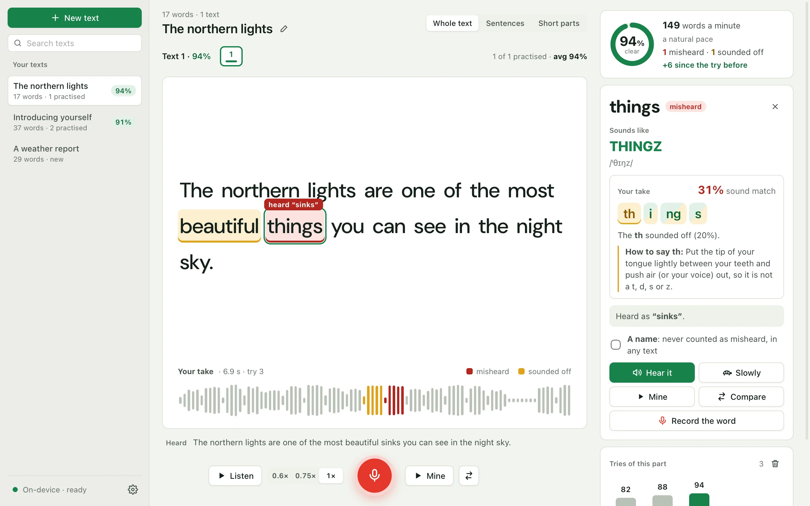

# Parrot

**Read a text aloud and see which words came out wrong.**

**[Download for macOS, Windows and Linux](https://qwertymuzaffar.github.io/parrot/)** · [Website](https://qwertymuzaffar.github.io/parrot/)



Parrot is a free, open-source desktop app for practising spoken English. Paste anything you need to say out loud (a job
interview introduction, a talk, a script), listen to it read correctly, record yourself, and Parrot shows you word by
word what came out wrong, how each word should sound, and lets you hear yours and the correct one side by side.
Transcription runs on your device (Whisper, offline): your voice is never uploaded.

## How it works

- **Listen.** Your text is split into sentences or short parts, and each one is read to you at the speed you choose,
  with the word being spoken lit up.
- **Record.** Read the part aloud. Parrot checks it two ways:
  - **Speech recognition** ([Whisper](https://github.com/openai/whisper) through
    [whisper.cpp](https://github.com/ggerganov/whisper.cpp)) writes down what it heard, without knowing the text. A word
    it heard as something else, or not at all, turns **red**, with what it heard.
  - **Forced alignment** finds each word of the text in your recording and scores how well the sounds match it. A word
    that scores clearly low turns **amber**: the listener guessed it, but it didn't sound right. The aligner is a
    wav2vec2 model trained on Mozilla Common Voice, so accents are expected, not marked down.
- **Fix.** Click any word to see how it sounds (a respelling like *sik·STEEN* and its IPA, from the
  [CMU Pronouncing Dictionary](https://github.com/cmusphinx/cmudict)), hear it alone or slowly, hear your own, or both
  one after the other. The card also shows your take of the word: its sound match as a percentage, and its letters
  grouped into the sounds they spell (*th·i·ng·s*), each green, amber or red (half green when it was right but not
  sure), with the weakest one named and a tip on how to make it. You can also record just that word, as often as you
  like: each try gets its own sound match and history, without touching the sentence's score. Every try is kept, so
  you can watch your score go up.

## Download

Get Parrot from the [website](https://qwertymuzaffar.github.io/parrot/) or the
[latest release](https://github.com/qwertymuzaffar/parrot/releases/latest).

| System | File | Needs |
|---|---|---|
| macOS, Apple chip (M1 and newer) | `Parrot-macOS-Apple-chip.dmg` | macOS 11 Big Sur or later |
| macOS, Intel | `Parrot-macOS-Intel.dmg` | macOS 13.4 Ventura or later |
| Windows | `Parrot-Windows-setup.exe` or `Parrot-Windows.msi` | Windows 10 or 11, 64-bit |
| Linux | `Parrot-Linux.AppImage`, `Parrot-Linux.deb` or the `.rpm` | 64-bit; Ubuntu 24.04, Fedora 40, Debian 13 or newer |

The installers are not signed with paid developer certificates yet, so the first time you open Parrot:

- **macOS:** if it says Apple cannot check Parrot, right-click the app and choose **Open**, or go to System Settings →
  Privacy & Security → **Open Anyway**. Once is enough.
- **Windows:** if SmartScreen says it protected your PC, click **More info** → **Run anyway**.

## On first launch

Parrot downloads its two speech models once, about 800 MB, then works offline:

| Model | Size | Source | Licence |
|---|---|---|---|
| Whisper small (English), for speech recognition | 488 MB | [ggerganov/whisper.cpp](https://huggingface.co/ggerganov/whisper.cpp) | MIT |
| wav2vec2 large XLSR-53, English, for the sound scores | 317 MB | [jonatasgrosman/wav2vec2-large-xlsr-53-english](https://huggingface.co/jonatasgrosman/wav2vec2-large-xlsr-53-english), exported to ONNX and quantised to 8 bits; served from this repository's `models-v1` release | Apache 2.0 |

The pronunciation dictionary ([CMUdict](https://github.com/cmusphinx/cmudict), BSD-style licence) is built in.

Texts and recordings are plain files in the app's data folder (macOS:
`~/Library/Application Support/io.github.qwertymuzaffar.parrot`, Windows: `%APPDATA%\io.github.qwertymuzaffar.parrot`,
Linux: `~/.local/share/io.github.qwertymuzaffar.parrot`). The models are in its `models` folder, except on Windows,
where they stay out of the roaming profile, in `%LOCALAPPDATA%\io.github.qwertymuzaffar.parrot\models`. A deleted
text goes to its `trash` folder and is erased for good 30 days later; Settings opens the folder and empties the trash.

Parrot looks for a new version only when you click **Check for updates** in Settings: it asks GitHub for the latest
release, and sends nothing else.

## Development

Requirements: Node 22+, Rust, and CMake (to build whisper.cpp).

```bash
npm install
npx tauri dev                       # the desktop app, with the engine built in
npm test                            # interface tests
cd src-tauri && cargo test --lib    # engine tests
```

The engine (`src-tauri/src`): `store.rs` keeps texts and tries, `audio.rs` cleans a take, `asr.rs` runs Whisper,
`align.rs` places each word and scores it and its letters, `text.rs` compares what was read with what was heard,
`sounds.rs` respells a word. Opened in a plain browser (`npx ng serve`), the interface runs on a demo engine kept in
memory (`src/app/core/demo-engine.ts`): sample texts and tries, and made-up scores, for working on it and for screenshots.

### Intel Macs

ONNX Runtime publishes no Intel Mac build after 1.23, so Parrot asks only for the 1.23 API and the Intel build links
Microsoft's [ONNX Runtime 1.23.2](https://github.com/microsoft/onnxruntime/releases/tag/v1.23.2), shipped inside the
app. To build it on a Mac (an Apple chip Mac runs the result through Rosetta):

```bash
curl -sSL https://github.com/microsoft/onnxruntime/releases/download/v1.23.2/onnxruntime-osx-x86_64-1.23.2.tgz | tar xz
mv onnxruntime-osx-x86_64-1.23.2 .ort-intel
rustup target add x86_64-apple-darwin
ORT_LIB_LOCATION=$PWD/.ort-intel/lib ORT_PREFER_DYNAMIC_LINK=1 MACOSX_DEPLOYMENT_TARGET=13.4 \
  npx tauri build --target x86_64-apple-darwin --config src-tauri/tauri.intel.conf.json
```

### Releasing

1. Set the version in `src-tauri/tauri.conf.json` and `src-tauri/Cargo.toml`.
2. Create the draft release first (the workflow's token was refused creating one for 0.1.1):
   `gh release create v0.1.2 --draft --title "Parrot v0.1.2" --notes "draft"`.
3. Tag and push: `git tag -a v0.1.2 -m "Parrot 0.1.2" && git push origin v0.1.2`. The `Release` workflow builds all
   four installers into the draft, each also under a fixed name (`Parrot-macOS-Apple-chip.dmg`, ...).
4. Check the files, write the notes, and publish the draft.

## Roadmap

1. A natural offline reference voice (Kokoro) for every text, which also makes the sound scores more exact.
2. More languages than English.

## Website

The download page is `docs/`, served by GitHub Pages. Its download buttons link to the fixed file names through
`releases/latest/download/`, so they start the download directly and nothing on the page needs changing for a new
version. When `site.css` changes, raise the `?v=` number on its links so browsers don't mix an old stylesheet with a new
page.

## Licence

MIT. The models keep their own licences (above). The app builds in [whisper.cpp](https://github.com/ggml-org/whisper.cpp)
(MIT), [ONNX Runtime](https://github.com/microsoft/onnxruntime) (MIT), the [ort](https://github.com/pykeio/ort) crate
(MIT) and CMUdict (BSD-style); their notices are in [`THIRD-PARTY-NOTICES`](THIRD-PARTY-NOTICES), which ships with every
installer. The app and the website use the
[DM Sans](https://github.com/googlefonts/dm-fonts) font (SIL Open Font License, `docs/fonts/OFL-dm-sans.txt`).
